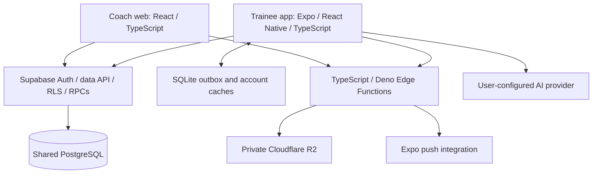

# Current architecture

Status: implemented topology; end-to-end gaps remain. Owner: TRACE maintainers. Updated: 2026-10-31. Sources: application manifests, `src/`, `supabase/`, companion source, and [diagnosis](../qa/diagnosis-2026-10-31.md). This document does not establish deployed configuration.

## Boundaries

TRACE owns canonical migrations and backend functions. TRACE-client owns mobile persistence and integrations. Both access the same data project using independent sessions; RLS and scoped RPCs are the trust boundary. Client role gates provide UX, not authority. The diagnosis identifies a mobile coach-role gate mismatch; coaches using the dashboard is intended behavior, not proof that the mobile gate currently rejects every coach.

Coach `programs` and trainee `workout_programs` / `program_days` / `program_enrollments` are separate models. Their existence does not establish a coach-to-trainee delivery bridge. The routed coach workout library/calendar use local memory; durable template helpers exist but are not a verified authoring flow.

## Data flows

- Mobile workout/session/set and nutrition logging await SQLite persistence, then sync stable IDs to PostgreSQL. Previously downloaded workout content supports offline reads. Details: [offline contract](offline-sync.md).
- Session delivery uses `sync_workout_session`; steps use `wearable_biometrics.step_count`; cardio uses `cardio_entries`. Check-in submission omits server-stamped `coach_id` and includes `scheduled_for`. Details: [shared data contract](client-contract.md).
- `join_program_by_token` clones permitted source templates/items and program days into recipient-owned personal records; rest/repeated days remain distinct. Source deletion should not break the private copy.
- Coach analytics use a verified-account in-memory cache of complete five-RPC snapshots with 30-second freshness and shared pending requests. Mount/focus reuse fresh results; visible polling checks freshness every 30 seconds, and explicit Refresh bypasses freshness. Failed refreshes retain labeled previously loaded values; account/profile/role changes and auth-shell unmount invalidate cached results and late responses. Roster/check-in/form-check reads remain independent. See [dashboard behavior and controlled request counts](../features/coaching.md#dashboard-analytics-caching); no latency or deployed acceptance is established.
- Media uploads use signed R2 PUT URLs; reads use a signed GET handler. The current entitlement model, unsupported progress-photo kind, standalone playback, and CORS need repairs before secure end-to-end claims. See [media decision](decisions/0001-media-storage.md).
- Coach Brain persists placeholder chat. Mobile AI calls configured providers directly; native config is currently device-global. Neither path establishes shared AI tools/retrieval. See [AI specification](../features/ai.md).

## Verification boundary

Canonical SQL and generated types live in code. PGlite SQL tests cover selected ownership/transaction flows, literal contract checks cover table/RPC names, and application tests cover selected logic. These checks do not validate all request shapes, deployed Deno handlers, Auth providers, Realtime, native SQLite, R2, paid inference, or push. [Shared acceptance](../qa/cross-app-acceptance.md) and [mobile acceptance](../../../TRACE-client/docs/qa/mobile-acceptance.md) define the additional checks.

The [target architecture proposal](../planning/architecture-evolution.md) covers query caching, consolidated reads, durable jobs, shared AI, and conditional Redis. Keep proposed components out of diagrams of current implementation until code and evidence establish them.
