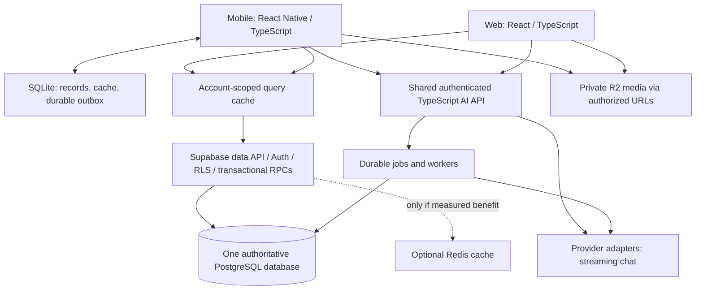

# Architecture evolution: responsive tracking and shared AI

Status: Proposed; documentation integration is authorized, implementation is separate work. Owner: TRACE maintainers. Updated: 2026-10-31. Source: the architecture recommendations in the project-owner discussion, grounded in inspected source. External technical references appear below. No latency benchmark, vendor purchase, or AI funding change is approved by this proposal.

## Outcome and target topology

Make food/set entry immediate, reopen useful screens from local data, deliver correct shared records to coaches, and add AI without blocking core tracking. Keep the [existing TypeScript/PostgreSQL platform](../architecture/decisions/0002-shared-platform.md).

The clients have separate cache instances; the diagram's cache node represents a common strategy, not shared in-memory state. Binary delivery may use an appropriately authorized CDN; caching private signed responses must preserve entitlement and expiration.

## Module boundaries

| Module | Owns | Boundary |
| --- | --- | --- |
| Nutrition | Food sources/servings, recipes, intake snapshots, targets | AI estimates require validation/review; coach target authority is explicit |
| Training | Exercise catalog, templates, plans, sessions, sets | Preserve performed history when plans change |
| Coaching | Relationships, assignments, check-ins, media review | Resolve permissions from the current allowed relationship |
| Messaging/notifications | Conversations, inbox, preferences, delivery | Paginated history; accepted/sent/delivered are distinct |
| AI | Provider adapters, context retrieval, proposals, jobs | Authorized context and reviewable actions; no unbounded database access |
| Analytics | Derived daily/weekly summaries | Canonical logs remain source records; corrections refresh summaries |

Use modules within the shared backend first. Simple RLS-scoped reads can continue through Supabase. Use transactional RPCs for aggregate relational writes; server functions handle secrets and external operations. Long processing goes to workers with durable queue state, bounded retries, idempotency, and failure visibility.

## Performance sequence and acceptance

| Phase | Change | Evidence required before completion |
| --- | --- | --- |
| 0 | Fix diagnosed authorization, persistence, and error paths | Relevant finding's acceptance passes; no cached false success |
| 1 | Baseline real flows | Record device/network, data size, both revisions, cold/warm startup, screen-ready time, p50/p95/p99 where sample size supports them |
| 2 | Local reads and query caching | Cached screens reopen; stale data is marked/refreshed; account switches reveal no prior user's data; fewer duplicate requests |
| 3 | Efficient reads and SQL | Paginate/search catalogs; date-scoped totals; compare query plans/row counts and latency under realistic RLS |
| 4 | Consolidated summaries where beneficial | Compare existing five parallel dashboard RPCs with a consolidated response/derived daily summaries; adopt only on evidence |
| 5 | Shared AI/jobs | Meet the [AI acceptance criteria](../features/ai.md); record queue delay/failures and provider errors |
| 6 | Redis or service extraction if justified | Demonstrate net latency/load/cost benefit and correct invalidation/authorization under failure |

Candidate query-cache library: TanStack Query in both clients. Set freshness by data type; invalidate affected account-scoped keys after mutations. SQLite remains durable mobile storage; Zustand holds transient UI state. Query caching alone does not implement offline write delivery.

Phase 0 progress (2026-10-31): [D02 shared Edge CORS](../qa/edge-cors-2026-10-31.md) is implemented and locally regression-tested. Deployed/browser acceptance and the other diagnosed authorization/persistence/error repairs remain open. This limited prerequisite does not establish completion of phase 0 or implementation of later caching/AI phases.

Use HTTP cache validators for reusable eligible reads. Version public assets. Compress payloads, resize images, reduce sequential round trips, virtualize long lists, and avoid whole-screen renders on every timer tick. Place API/data/cache in a region appropriate to users; preserve co-location for database-heavy operations. Measure before adopting multi-region complexity.

Verify indexes for actual account/date/relationship filters with query plans; avoid blanket index additions. Add summaries when full-history aggregation becomes expensive, with a defined refresh/correction policy. Use bounded concurrency and connection pooling appropriate to the deployment; retries need backoff and idempotent writes.

## Redis policy if introduced

Cache-aside for demonstrably repeated expensive reads: cache lookup, database miss load, bounded TTL. Commit database writes before invalidating affected entries; handle concurrent stale repopulation through versioning or equivalent ordering. Include user/tenant scope and relevant permission/data revisions. Authorization is checked independently. Prevent stampedes with request coalescing and expiry jitter where useful; plan database load during cache outages. Private data and pending writes retain durable storage outside Redis.

## Shared AI migration

Current mobile BYO-key integration remains the baseline. Before adopting a TRACE-funded gateway, decide funding, consent/data routing, provider ownership, limits, retention, and whether BYO-key continues. Keep company-owned keys on the server. Retrieve only relevant permitted context; stream conversational output; persist long jobs with cancellation/retry semantics. Deterministic code/SQL computes totals and metrics. Validate generated structures, preserve uncertainty/provenance, and obtain user review before committing generated meals/programs. Add retrieval only for a defined corpus and citation requirement; no vector vendor is selected.

## Technical references

- [TanStack Query cache defaults](https://tanstack.com/query/latest/docs/framework/react/guides/important-defaults)
- [Supabase query optimization](https://supabase.com/docs/guides/database/query-optimization)
- [Supabase Edge Function limits](https://supabase.com/docs/guides/functions/limits)
- [Redis cache-aside](https://redis.io/docs/latest/develop/use-cases/cache-aside/)
- [Android offline-first guidance](https://developer.android.com/topic/architecture/data-layer/offline-first)

References support design techniques; they do not establish TRACE's measured performance or current service entitlements.
