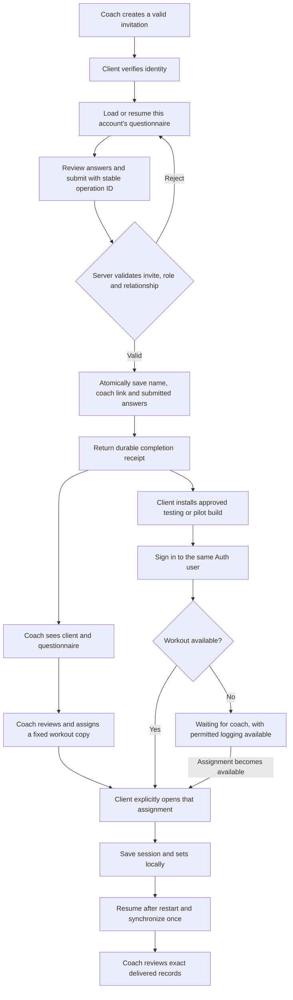

# Client workflow and missing-feature completion plan

Status: staged delivery plan; first local onboarding/handoff slice implemented, remaining phases and release acceptance open. Owner: TRACE maintainers / product owner. Updated: 2026-11-06 (Asia/Singapore). Scope: invited client onboarding, coach review, mobile handoff, core coaching delivery, and the remaining feature backlog. Sources: inspected onboarding/auth/roster/workout paths, [UI map](../qa/ui-navigation-map-2026-11-05.md), [feature specifications](../features/README.md), [current preflight](../qa/pilot-preflight-2026-11-06.md), and [open decisions](open-items.md).

Execution update (2026-11-07): [local onboarding workflow evidence](../qa/onboarding-workflow-2026-11-07.md) owns the first implementation slice, actual checks and deployment boundaries. It covers resumable drafts/atomic completion, coach review, mobile email-code option/role handoff, waiting states and complete-day Home reads. This is not completion of all phases below. Email delivery/template and hosted/native acceptance remain open; no external services were changed. Existing questionnaire-history access is preserved pending an explicit change.

Owner continuation choices (7 November): include full meal-plan delivery; program/group changes automatically update upcoming assignments while started/completed/pending work retains captured history; social is private by default with explicit sharing to approved followers; AI unavailable for V1. Signing/device acceptance is deferred until application completion. [Nutrition delivery](../qa/nutrition-delivery-2026-11-07.md) is implemented locally and being verified; [OpenGym review](../research/opengym-integration-2026-11-07.md) found that its images/animations require a separate license and no dataset was imported. The standalone fixed-workout copy policy remains distinct from automatic program/group delivery updates.

## Outcome and scope

A client can complete setup once, sign in to the same account on mobile, understand whether a coach has assigned training, save work durably, and have the permitted coach review it. Errors must preserve recoverable progress. Every visible feature must either complete its promised journey or explain its availability honestly.

Already approved: selected-user private pilot; fixed-copy workout assignments with explicit later updates; registered media ownership and legacy URL denial; current-coach historical form-video access, former-coach denial of new URLs and normal bearer expiry. Retain these decisions. The authentication recommendation, pilot exclusions, questionnaire-history policy and expansion features below are proposals; this document does not silently approve them.

Keep TRACE web, TRACE-client, Supabase Auth/PostgreSQL/Edge and existing R2/Vercel. Reuse locally verified workout authoring, assignment receipts, outbox, owner-scoped caches and lifecycle repairs. No new service, Redis, queue vendor or AI subsystem is necessary to finish the deterministic core journey. The deployed system is behind the local source; see the preflight rather than treating current production as containing these repairs.

## Proposed client and coach journey

Coach review is a work item, not a new approval requirement for joining a coach. Linking remains immediate under the approved invite/claim rules. Do not introduce approval queues, payments or an automatic program generator as hidden prerequisites.

## State model: avoid one ambiguous complete flag

| Independent state | Meaning and user feedback | Authority |
| --- | --- | --- |
| Identity: signed out / verifying / authenticated / wrong role | Verify identity; coach accounts get a clear web-dashboard handoff, not the trainee coach picker | Supabase Auth and role-checked profile |
| Relationship: unlinked / linked | Invite resolves the intended coach; app-first clients use the existing picker/code path. Do not silently switch an existing relationship | Server profile and controlled claim operation |
| Questionnaire: not started / draft / submitted | Resume saved answers; submit once; receipt confirms persistence. Missing questionnaire history must not automatically lock out existing clients | Owned draft/submission and operation receipt |
| Coach work: needs review / reviewed | Coach can open real answers and record review; this is separate from assignment availability | Authorized coach operation |
| Training: waiting / assigned / in progress / completed | Waiting is an honest empty state. Active drafts keep their exact assignment ID even when newer copies arrive | Assignment records plus account-scoped local draft |
| Delivery: saved locally / syncing / confirmed / failed | Local save is success for persistence; cloud confirmation is separately visible; failure keeps work and supports retry | Durable outbox and server acknowledgement |

## Phase 0 — establish a usable verification environment

Use the existing project identities and secrets already discovered; do not ask the owner to re-enter them. Establish a working isolated restore target and demonstrate restoration of a protected backup before changing the existing hosted database. Docker's Linux engine was unavailable during preflight; no physical backups were returned. Resolve this concrete environment gate before rollout, not by disabling the requirement.

Prepare two dedicated coaches and two trainees, their intended relationships, and a signed testing device. Provisioning, real email delivery, paid infrastructure, live migration and public release remain separate authorized operations. Use controlled email delivery for Auth acceptance; mocks are not proof that real email/login works. Inspect existing hosted definitions before replaying reconciliation SQL. Record exact migration/function/client versions.

**Exit evidence:** isolated restore report, dedicated fixture identities without credentials in docs, reachable Auth/API/Edge/R2 and an identified device/build. Local implementation in phases 1–4 can progress before this environment is ready; it cannot be called hosted acceptance.

## Phase 1 — make onboarding reliable and permission-checked

### 1A. One identity across web and mobile

Recommended mobile email flow: request an email one-time code, verify it, then load the same Supabase user/profile used by web onboarding. Retain Google as an alternative. A code entry flow avoids requiring app links just to establish sign-in; provider email templates, delivery, expiry and resend limits still need real verification. Keep passwords optional rather than making a new magic-link client invent a password without a setup path. If password login is retained as a primary path, provide verified setup/reset explicitly.

Test stable Auth user ID across web and mobile; an equal email label alone is not proof of account identity. Never copy browser session tokens into a handoff URL. Handle expired/invalid codes, resend cooldown, cancelled login, sign-out, role mismatch and the returning-user case. Initial offline use needs one successful authenticated profile/content download; retain existing account-scoped offline reopening afterward.

### 1B. Recoverable drafts

Use an account-owned server draft for this invitation and a versioned question configuration. Save at step boundaries, show saving/failure, and restore the last confirmed draft after refresh or changing devices. Save only for the captured account and reject stale revisions rather than overwriting a newer draft. Keep an operation ID in account-scoped state for retry; avoid introducing a general browser cache of health answers or tokens. A failed online draft save must not be described as safely persisted. Do not add a second offline-write engine for this web form.

An interrupted user may remain authenticated with an incomplete questionnaire. Auth account creation cannot be rolled back by the later database transaction; this is a valid resumable state. Existing linked clients and their pending mobile logs must not be reblocked solely because an older questionnaire lacks a new completion receipt. App-first signup and invited signup converge on the same identity/relationship model; making questionnaires mandatory for every app-first user is a separate scope decision.

### 1C. One atomic completion operation

Add a narrowly scoped server RPC for invited completion, reusing the existing claim rules internally. In one transaction:

1. Authenticate the caller and verify trainee role.
2. Resolve and validate the server invitation; derive coach identity from it, not URL parameters or client-provided coach identity. Bind the accepted question configuration/version to the draft.
3. Lock the profile/draft as needed; reject an existing different coach. Re-check any invitation revocation/version policy before committing.
4. Validate required answers, shapes and size limits; copy the supported name fields, establish the coach relationship, and save a submitted answer snapshot.
5. Store a stable operation ID and canonical request identity with the receipt. The same operation/content returns the original result after response loss; changed content under that ID is rejected.
6. Commit all database changes, then let the UI show completion. Failure changes none of those database records.

Harden direct onboarding INSERT permissions so callers cannot submit on behalf of another trainee or nominate a coach unrelated to the authenticated client. Use scoped RPC permissions/RLS and fixed function search paths, not service credentials in the browser. Preserve valid older clients during migration: add nullable receipt/version metadata without deleting old responses; retain compatible claim signatures; sequence any direct-write cutoff with supported web versions. Legacy query-string invitations must not become a trusted identity source—provide an explicit regenerate/upgrade path where needed.

Reopening a submitted invitation shows the prior confirmation and saved answers. An intentional correction creates a new explicit revision with history; a retry does not create another submission. Do not merge or delete historical duplicates until a separate reconciliation procedure is reviewed.

**Exit evidence:** transaction rollback after each failure point; same-ID replay after a lost response; changed-content rejection; double taps; expired/revoked invite; account/coach mismatch; direct forged inserts; refresh/resume; and concurrent submissions in real PostgreSQL. Confirm positive normal access as well as denials.

## Phase 2 — close the coach-review and mobile handoff gaps

- Add a client detail entry in the existing roster with questionnaire answers grouped by section, submission date/version and review state. Fetch only when opened, page submission history and render answers as text. Include loading, no submission, rejected access and retry states. Do not build a second client roster.
- Preserve the current explicit questionnaire read policy initially. Historical questionnaire visibility after coach reassignment requires its own decision; the approved historical form-video rule does not automatically authorize access to questionnaire health data.
- Completion provides a real authorized testing/pilot installation destination, account email and accurate next steps. Remove misleading live-store calls to action while store listings do not exist. Distribution links contain no session credentials.
- On mobile, a linked client enters Home; an unlinked client reaches coach selection; a wrong-role account receives a clear coach-web handoff. Show “Waiting for your coach to assign training” where appropriate, and allow already supported manual logging.
- Show workout availability independently of questionnaire completion. Refresh on relevant screen focus and after assignment changes; add broader realtime delivery only if needed. Reuse the actual fixed-copy assignment flow.
- Do not promise an assigned nutrition plan in onboarding copy until a plan/target bridge is implemented and accepted. Questionnaire goals and dietary answers are information for coach review, not automatically approved nutrition prescriptions.

**Exit evidence:** a newly onboarded client appears by submitted name, the intended coach reads the exact answers, an unrelated coach cannot read them, the client signs into mobile under the same user ID, and the empty/assigned states reflect real data. The complete journey must be exercised through UI and hosted services.

## Phase 3 — verify core training and nutrition delivery

Preserve the existing atomic private workout save and fixed-copy assignment RPCs. Extend their acceptance coverage rather than rewriting them. A coach chooses the linked trainee; a receipt records the assigned copy. Mobile opens that exact copy. When multiple copies exist, provide a deterministic visible selection and distinguish newest available from a currently running draft; do not silently replace a started workout. An assignment update is explicit and leaves performed history intact. This does not add calendar/group/program scheduling.

Retain the locally repaired occurrence-bound set IDs, prescribed rest, saved-workout Resume controls and finished-draft handling. Accept the real native path: download, go offline, select a non-default cached workout, log, kill/reopen, resume, reconnect and verify one matching server result. Simulate lost responses and parent-session delivery failure; retain recoverable records rather than clearing the queue.

For nutrition, retain the new pre-queue database-bound validation and complete-day Nutrition-screen reads. Verify Home summaries against the full same-day dataset too; a recent-50 dashboard query is not complete-day acceptance. Test original dates across midnight, account switches, server echo deduplication, fractional inputs, full-day totals above 50 entries and historical values after catalog edits. Resolve any verified precision/date mismatch with an explicit storage/display rule, not silent history rewriting.

Repair saved-meal parent/items creation through a single transactional operation with stable request/item IDs before advertising batch creation as reliable. Intake logging from that meal must preserve stable per-item IDs and explicit partial/retry state, or use a reviewed atomic batch queue operation. Do not report a multi-item meal fully logged after only some items persisted.

**Exit evidence:** two coaches/two trainees complete save → assign → exact mobile open → offline logging → restart → synchronization → coach review, with matching IDs/values and denied unrelated access. A dashboard count alone is insufficient.

## Phase 4 — finish media acceptance and exercise catalog groundwork

Deploy and accept existing D01/CORS/runtime repairs under the coordinated backend rollout. Preserve legacy denial and approved current/former-coach policies. Align each exposed upload/playback kind end to end; progress photos must either gain a complete authorized path or remain explicitly unavailable in the approved pilot scope.

For actual-object validation, extend the current issuance registry with a reviewed pending/ready lifecycle: authorize upload → PUT bytes → authenticate finalization → inspect object existence/actual size and type → mark ready → attach/view under normal entitlement checks. Metadata supplied before upload is not finalization proof. Preserve issued-object compatibility through an explicit verification/backfill path; do not relabel legacy references as trusted ownership. Test failed upload, finalization retry, forged attachment, foreign ownership, reassignment and URL expiry. Cleanup/deletion/retention must wait for agreed rules and preserve data referenced by pending writes.

Use the [exercise-source shortlist](../research/exercise-datasets-2026-11-06.md) to select a pinned dataset and verify metadata and media rights separately. A future importer should dry-run mapping/deduplication first, keep external IDs/provenance/license per asset and upsert one shared catalog. Import a curated subset before expanding. Paginate thin search results and fetch instructions/media on detail; download optimized media only when needed, with a bounded cache. Measure bytes and delivery cost. Public demonstration media and private client uploads must have separate access rules. No runtime dependency on GitHub raw URLs, per-user catalog copies, or bulk HD media preload is proposed.

**Exit evidence:** authorized upload/finalize/attach/playback plus negative tests through real Edge/R2 transports; for any imported catalog, reviewed source manifest, deterministic rerun without duplicates, measured storage and working paginated queries. No dataset import is approved by this plan alone.

## Other missing features: preserve a complete backlog

These are explicit follow-on workstreams. Recommended pilot exclusions require owner agreement; excluded does not mean completed or removed from the backlog.

| Workstream | Smallest complete workflow | Dependency / proposed order |
| --- | --- | --- |
| Coach nutrition targets/plans | Coach sets explicit targets/plan → validates/publishes → correct trainee receives it → logs compared against dated target version | Decide serving units, target authority and version semantics first; manual intake logging can precede this bridge |
| Programs and calendar | Published ordered program → explicit recipient/day mapping → timezone-aware calendar → exact mobile workout → reschedule/history rules | After single-workout acceptance; preserve separate personal-program and coach-catalog models |
| Training groups | Coach selects current members → explicit group delivery → each recipient has an authorized assignment → membership/revocation behavior is clear | After individual delivery and its membership/version policy; group metadata is not delivery |
| Vault/resources | Coach adds a real file/link → sets allowed recipients → trainee opens it → revocation enforced by server | Media finalization and recipient/access policy first |
| Messages/history | Recent messages → older pagination → realtime reconciliation → recoverable send failure | Validate above 200 records and across account switches; distinguish committed writes from uncertain responses |
| Notifications/push | Persist scoped event → unread inbox → respect timezone/preferences → provider send/ticket handling → device opens correct screen | Durable delivery event and native credentials; useful after core delivery, not proof of it |
| AI | Select permitted provider/funding/data scope → isolate credentials → review generated proposal → deterministic validation → normal authorized save | Product/consent/retention decisions first; coach placeholder must stay visibly unavailable |
| Social/leaderboards | Define audience/visibility → read permitted actual activity → pagination and follow/unfollow/error recovery | Explicit privacy/scope; no static feed presented as activity |
| Wearables/gym directory/measurements | Define source/units/permissions → import or save → deduplicate → display/recover | Separate product decisions; manual steps do not establish wearable ingestion |
| History, pagination, lifecycle leftovers | Reproduce a dated finding → fix its actual routed path → test sufficient volume and stale-account handling | Do not reopen verified D04 repairs or infer all old diagnosis items are still current |
| Operations/distribution | Restore evidence → chosen app identity/signing → exact accepted artifact → controlled rollout → monitoring and compatible recovery | Mandatory for release; backup, object recovery and pending device data are distinct |

Barcode scanning, Train Together, coach invite-email automation and billing remain outside the retained approved baseline. This plan does not revive them.

## Phase 5 — accept and release one complete journey

| Level | Required evidence | What it does not establish |
| --- | --- | --- |
| Logic/validation | Meaningful unit tests for bounds, parsing, routing decisions and operation identity | Actual database, identity or device behavior |
| Database and handler integration | Real constraints/RLS/RPC transaction/retry tests; real PostgreSQL concurrent cases; Edge auth/body/CORS tests | Native persistence or real provider/storage delivery when dependencies are controlled |
| Component/browser flows | Actual form/roster/sign-in/waiting/assignment controls with recoverable errors | Hosted service correctness if mocked |
| Hosted journey | Dedicated roles through actual Auth, PostgREST, functions and R2; unrelated account denials | Native kill/reopen, signing or offline SQLite |
| Native journey | Exact artifact/device identity; airplane mode, storage failure, force-kill/reopen, reconnect, expired session and account switching | All other OS/device combinations |
| Rollout/operations | Exact paired source/artifact IDs, migration/function versions, rollback/restore evidence and named incident owner | A broader feature set than the accepted pilot scope |

Maintain a requirement-to-test table for each workstream. Every promised button/action needs a success case, meaningful failure/recovery case, permission case where applicable, and delivery/readback assertion. Tests must verify observable user outcomes and exact stored IDs/values, not only that a mocked function was called. A missing required case is **not run**, not a pass. Keep implementation, local checks, staging, device and production columns separate on the existing board.

Run focused checks while editing; once compatible workstreams stop changing shared files, run one coordinated paired aggregate slot using the repository instructions. Capture exact source fingerprints. Freeze a paired candidate only after that boundary is stable. Do not regenerate a full artifact after each small edit. Release compatible schema/functions before dependent clients, with the special media maintenance order documented in the [preflight](../qa/pilot-preflight-2026-11-06.md). The six currently pending migrations plus any new onboarding work need reviewed ordering, not blind replay.

## Efficient implementation order and ownership

1. Prepare the restore/staging/device path while implementing the first bounded onboarding repair locally.
2. One canonical SQL/type owner implements draft/completion transaction, receipt and permission tests. Generate both apps' types; preserve other dirty work.
3. Web owner consumes that contract for resume/submit/confirmation and coach questionnaire detail. Mobile owner implements matching email authentication and explicit waiting/assignment states. Parallel work is allowed only once interfaces are fixed and file ownership does not overlap.
4. Complete the existing core workout/nutrition journey and media acceptance; fix only demonstrated failures. Follow-on bridges take separate tasks with their own accepted contracts.
5. One verification owner runs the coordinated aggregate, then the real hosted and native journeys; the release owner approves only a concrete candidate with its remaining exclusions documented.

These are proposed responsibilities, not new chat assignments. Creating the original plan was documentation-only; the 7 November local implementation is tracked separately in its evidence record. No deployment, provisioning or publication is established by this plan.

## Decisions to settle before the affected implementation

- Validate the locally implemented email-code handoff against the actual email template and same-account hosted/native journey before pilot acceptance.
- Confirm the pilot's advertised feature list and exclusions; do not call an unsupported route complete.
- Choose questionnaire correction/history access and draft/submission retention, including after coach reassignment. Do not inherit media rules implicitly.
- Choose nutrition target authority, serving rules and plan versioning before that delivery bridge.
- Choose rights-cleared exercise/media sources and acceptable media budget before import.
- Identify restore target, dedicated QA account authorization and final Android identity/signing/distribution; shared AI/provider choices remain separate.

## First implementation milestone: local slice implemented, acceptance pending

**Outcome:** a new invited client can submit once, recover from interruption or a lost response, appear in the correct roster and resume the same account on mobile.

**Contract:** authenticated, invite-derived, atomic profile/link/submission write with stable receipt; resumable account-owned draft; complete matching sign-in path; authorized questionnaire read UI. Preserve existing linked users, prior submissions and pending logs.

**Evidence required:** new email user → invitation → draft reload → submit → forced response loss/retry → one receipt/submission → correct coach review → same mobile Auth user → honest waiting state → explicit workout assignment/readback. Add wrong-role, forged coach, expired invitation, different existing coach, account switch and storage/network failure cases. Require hosted/native evidence before accepting the whole task; local subtasks may complete independently with their own boundaries.
