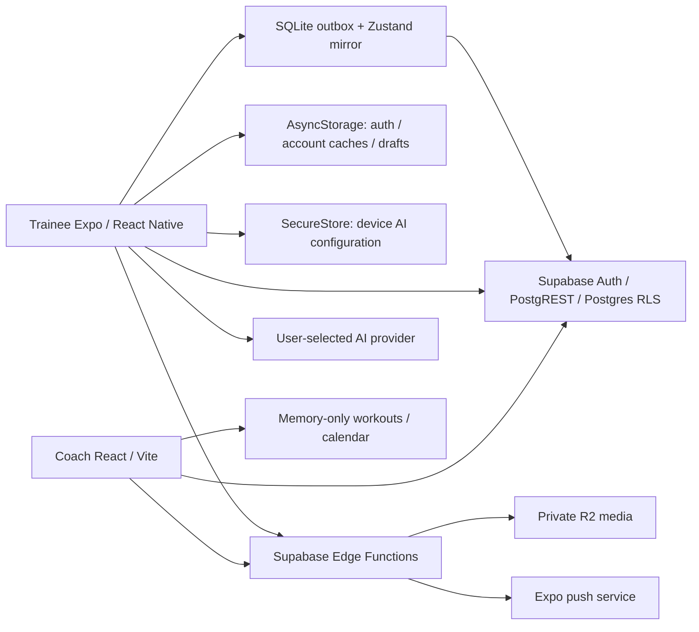

# System diagnosis: 31 October 2026

> Evidence record, not a fresh audit or production sign-off. Owner: TRACE maintainers. Integrated: 2026-10-31. Source: project-provided root `latest diagnosis.md`, SHA-256 `c184214f1f1e47df309b5db63b96aeb37c6e1554e655b8f925774142f31f6918`; that temporary input is removed after incorporation. Original audit scope/results below are attributed to that report, including working-tree changes. Documentation integration did not rerun its probes, tests, cloud checks or dependency audits. A later fix requires its own revision/acceptance evidence.

> All 25 findings D01-D25, original priorities, test results, limitations, coverage matrix, reproduction notes and substantive source anchors are retained. Large generated JSX/schema/dependency inventories are omitted as regenerable data. Findings feed [open items](../planning/open-items.md), [feature specs](../features/README.md), and [release acceptance](cross-app-acceptance.md). No finding is closed by this edit.


**Audit date:** 31 October 2026, Asia/Singapore.  
**Scope:** `C:/Users/imint/TRACE` (coach web app, canonical backend) and `C:/Users/imint/TRACE-client` (trainee app).  
**Checkout baseline:** coach `0667534`; client `774ab9d`, **including the existing uncommitted changes in both checkouts**. This report describes the inspected working copies, not just those commits or any deployed release.

## 1. Overall verdict

**TRACE has a substantial implemented data layer and client logging system, but the complete product is not yet verified or ready to be called fully working.** All existing automated suites passed. Both web builds passed. Important product paths nevertheless remain incomplete, and additional probes reproduced authorization, media-contract, notification, and development lifecycle failures.

The highest priorities are:

1. Fix media authorization: an authenticated user can attach a known foreign object key to their own set log and satisfy the playback function's authorization check.
2. Fix the Edge Function CORS contract: the installed Supabase SDK sends headers absent from the functions' preflight allowlist.
3. Connect the routed coach workout builder to durable workout templates and items; its current Save action saves only in browser memory.
4. Fix the coach hooks' Strict Mode lifecycle flags, which leave several development screens loading indefinitely.
5. Align progress-photo uploads and standalone form-check playback with the R2 functions.
6. Finish or clearly delimit coach programs, calendar scheduling, vault delivery, coach-to-client nutrition plans, coach AI, and notifications.
7. Complete live backend and signed-in device acceptance checks. Local tests are useful evidence, but do not establish deployment health.

No application fixes, migrations, deployments, credential changes, real messages, or production data mutations were made for this diagnosis. Temporary probes and build exports were placed in the OS temporary directory. Existing source edits were preserved. Normal builds updated generated output/cache files.

## 2. Evidence rules and limits

| Label | Meaning |
| --- | --- |
| **Reproduced** | Observed through an actual UI interaction, executed SQL, or execution of the actual function/hook source with controlled dependencies. The exact boundary is stated. |
| **Code-confirmed** | A path or missing integration is directly visible in the working source. Its deployed behavior was not independently exercised. |
| **Implemented; live unverified** | A frontend/backend path exists and may have local test coverage, but an authenticated deployed round trip was not established. |
| **Release gate / risk** | A configuration or acceptance requirement remains; this is not automatically a demonstrated runtime failure. |

**Priority:** P1 = repair before relying on the affected core/security/release path; P2 = material feature/reliability work; P3 = smaller quality/maintenance work. Feature completeness and defect severity are separate: an intentionally deferred feature is still incomplete, but is not automatically a security bug.

### Live access limitation

The two `.env.local` files contain the same Supabase project URL and the same public anonymous key. Required public configuration names are present. The local Edge environment contains the four R2 credential/configuration names. Values were not printed or copied into this report. Presence does **not** prove deployed secrets or validity.

Read-only HTTP probes attempted Auth health/settings, zero-row profile/progress-photo/session queries, and the four Edge Function URLs. All failed before receiving HTTP responses with Node `ENOTFOUND`. Direct DNS control queries for the configured host, `supabase.com`, and `google.com` returned `ECONNREFUSED`. This indicates a resolver/access limitation in this execution path; **it does not prove the Supabase project is down, deleted, or misconfigured**. The npm registry audit was reachable through its own network path.

Consequently, deployed migration history, real Auth providers, RLS through PostgREST, Realtime delivery, R2 credential validity/CORS/lifecycle, deployed function versions, paid AI inference, and push delivery remain unverified. There were no signed-in coach/trainee fixtures available for a live cross-account acceptance run. No R2 objects or personal health records were fetched.

### Browser verification boundary

The normal coach demo command still redirects an unauthenticated visitor to Login; it does not supply a preview coach through `useTraceUser`. To inspect protected coach UI safely, a **temporary local Vite harness** substituted only that hook's profile result with a fictional coach. Demo-mode Supabase fetches returned 503 and blocked cloud operations. The routed components and their actual local state logic were otherwise used. This is UI-fixture evidence, not a successful real login or database write.

The client used its existing `npm run preview -- --port 8084` mode. Its banner explicitly says cloud features require login, sync has no active account, and backend writes are blocked. GET requests may still fail against the configured backend. Client previews and web exports do not prove Android/iOS permissions, device SQLite durability, media playback, or push delivery.

## 3. Executed verification

| Check | Result | What it establishes / does not establish |
| --- | --- | --- |
| Coach `npm test` | **10 files, 39 tests passed** | Pure utilities and related covered contracts; not full screen/button coverage. |
| Coach `npm run lint` | **Passed with 5 warnings** | Fast Refresh export warnings in badge, toast, field and AppShell files; no lint errors. |
| Coach `npm run build` | **Passed** | TypeScript and production Vite compilation. Main JS chunk 1,085.05 kB / 303.57 kB gzip; size warning. |
| Coach `npm run test:db` | **11 SQL scenarios passed** | Canonical migrations execute in disposable PGlite; targeted real SQL/RLS flows pass. |
| Coach `npm run test:contracts` | **Passed** | Literal `.from()` / `.rpc()` names exist in the canonical schema. It does not verify payloads, joins, response shapes, Edge APIs, or UI reachability. |
| Coach `npm run db:types:check` | **Passed for both apps** | Generated types agree with the locally replayed schema. Most Supabase hooks still use manual shapes/casts; generated types do not make every request type-safe. |
| Client `npm test` | **61 files, 338 tests passed** | Utilities, selected hooks/components, outbox behavior and storage orchestration under test dependencies. |
| Client `npm run typecheck` | **Passed** | Client TypeScript compiles. |
| Client production web export | **Passed; 2,011 modules** | Fresh Expo web bundle exported to the OS temp directory; main JS about 3.7 MB. |
| Client Android JS/assets export | **Passed; 2,513 modules; ~6.3 MB Hermes bundle** | This is bundle compilation, not a fresh APK install or device acceptance run. |
| Dependency inventory | `npm ls --depth=0` exits 0 in both | No missing/invalid top-level dependency error. Coach has several extraneous WASM-support packages. No clean reinstall was performed. |
| Coach production dependency audit | **Exit 1; 1 high advisory** | React Router 8.2.0 flagged; applicability discussed in section 8. |
| Client production dependency audit | **Exit 1; 22 flagged packages** | 1 critical, 7 high, 12 moderate, 2 low; inherited dependency counts are not 22 independently exploitable app bugs. |
| Schema inventory | **55 public tables, 27 public functions** | All 55 tables have RLS enabled; `platform_settings` has no client policies and is default-deny. Not proof every policy/function is correct. |
| Additional Edge/source probes | **Reproduced failures**, section 4 | Actual source executed after TypeScript transpilation, with mocked Auth/DB/signing/Expo transport. No deployed Deno/R2 execution. |
| Hook lifecycle differential | Normal setup clears loading; Strict Mode replay does not | Actual `useClients` source under a small hook-effect runner, corroborated by browser UI. |
| Coach browser smoke | All 17 protected route shells rendered in the fixture | Several lists remain Loading due to the lifecycle defect. Shell rendering is not functional acceptance. |
| Client browser smoke | Navigated 27 static routes including home, training, nutrition and AI settings | Home/training/nutrition/notifications/AI settings were inspected in settled UI. Rapid route snapshots were sometimes incomplete, so the route sweep is **not** reported as 27 functional passes. |

The SQL suite specifically covers profile privilege restrictions, repeated workout delivery and isolation, cardio aggregation/deletion, check-in/form review isolation, private token program cloning and malicious source rejection, coach nutrition/steps visibility, dated weigh-ins, folder ownership/deletion behavior, draft-baseline compatibility and optional seed execution.

## 4. Prioritized findings

### D01 — P1 — Media playback authorization can be satisfied with a foreign object key

**Reproduced at SQL + function boundaries.** `set_logs.form_video_s3_key` accepts an arbitrary string on an owner-created log. An authenticated disposable trainee successfully inserted and selected their own set log containing `form-video/another-user/known-victim-key.mp4`. `r2-get-url` then authorizes a non-avatar key solely by finding a visible `set_logs` row referencing it. It never establishes that the referenced object belongs to the uploader or to an authorized media record.

**Impact:** if an authenticated user learns a private object key, they can reference it in their own log and obtain a signed URL. UUID key names reduce guessing; they do not provide entitlement. This is not a claim that another user's media was accessed during the audit.

**Repair/acceptance:** create trustworthy media ownership records at upload issuance/finalization, validate attachment ownership server-side, and authorize viewing through the actual permitted relationship. Test owner, connected coach, unrelated trainee/coach, changed coach, fabricated reference, and known foreign key. A prefix check can help but must not replace the intended coach access model.

**Local implementation evidence (2026-11-05):** server-issued ownership registry, attachment validation, current-coach authorization and focused SQL/handler regressions are recorded in [D01 media entitlement evidence](media-entitlement-2026-11-05.md). Hosted migration, deployed Edge handlers, real R2 behavior and staging/device acceptance remain open; this local evidence does not close the release gate.

Evidence: coach `supabase/functions/r2-get-url/index.ts`; `r2-presign/index.ts`; `supabase/migrations/20260717000000_init_trace.sql`; later set-log RLS migrations; temporary schema and Edge probes.

### D02 — P1 — Browser Edge Function CORS does not allow the installed SDK's request headers

**Reproduced as a contract mismatch.** Actual installed `supabase.functions.invoke()` produced `apikey`, `authorization`, `content-type`, and `x-client-info`. Actual function OPTIONS responses allow only `authorization, content-type`. The missing headers are `apikey` and `x-client-info` in `r2-presign`, `r2-get-url`, and `trace-brain`.

**Impact:** a browser making these cross-origin requests against these handlers cannot satisfy the preflight contract. Coach avatar upload, signed media URL resolution and Brain requests are affected even with correct credentials. Native HTTP does not share browser CORS enforcement. Deployed gateway/header overrides were not verified.

**Repair/acceptance:** centralize CORS for the actual SDK header set and test OPTIONS plus authenticated POST from the real coach/mobile-web origins. Verify R2 bucket CORS separately; it is a different hop.

Evidence: all three function CORS objects; installed `@supabase/supabase-js` and `@supabase/functions-js`; SDK-header/OPTIONS probe.

### D03 — P1 — The routed coach workout builder does not save a usable workout

**Reproduced in browser; code-confirmed.** On `/workouts`, Create workout opens a builder. AI Generate has no handler. The drag area has no exercise-drop implementation or item collection. Description and a secondary search are uncontrolled inputs without save integration. Save & Close calls `addWorkout({name, category})` in `useWorkoutLibrary`, whose store is module memory. A fixture workout appeared in the table and disappeared on full reload. No exercise prescription was saved.

The real `TemplateBuilder` + `useTemplateSave` path can insert `workout_templates` and `template_items`, but repository reference search finds no routed component mounting that builder. Backend assignment tests therefore do not establish a working authoring UI.

**Repair/acceptance:** connect the main builder to canonical templates/items, provide item selection/order/targets and actual assignment, persist atomically, reload, then open and complete the exact assigned workout as the trainee. Either implement AI Generate or label/disable it explicitly.

Evidence: coach `src/components/pages/WorkoutsPage.tsx`, `src/hooks/useWorkoutLibrary.ts`, `src/components/coach/TemplateBuilder.tsx`, `src/hooks/useTemplateSave.ts`.

### D04 — P1 in development — Strict Mode permanently invalidates mounted flags

**Reproduced.** `src/main.tsx` mounts React StrictMode. Sixteen coach hooks initialize `mountedRef` with true, but their effect only sets it false during cleanup and never restores true on setup. Development effect replay runs cleanup and then setup, leaving the ref false. Subsequent completed requests are ignored by affected hooks.

The actual `useClients` source probe returned `loadingCleared: true` without replay and `false` with replay. The fixture roster continued to show Loading across subsequent observations. Similar patterns occur in programs, meals, meal plans, foods, equipment, exercises, groups, roadmaps, vault, tags, allowlist, templates, invite link, AI chat and profile refresh. The exact symptom depends on where each hook checks the flag.

**Limit:** this particular replay is a development behavior; do not describe it as proof that the production build always hangs. Account-change/cancellation correctness still merits separate review.

**Repair/acceptance:** make setup/cleanup symmetric or use correctly scoped cancellation/revision guards. Exercise mounted hooks under StrictMode, unmount, account changes, success and rejected requests.

### D05 — P1 for progress photos — Client and server media kinds disagree

**Reproduced.** Client capture uploads with `kind: 'progress-photo'`, which client policy accepts. `r2-presign` has only form-video, meal-photo, coach-image and file. An otherwise valid progress-photo request returns **400, Unknown media kind**.

Even after upload support is added, `r2-get-url` does not authorize `progress_photos.photo_s3_key`, so timeline playback still needs its own secure path. The canonical migrations already create `progress_photos`; old client comments claiming the table does not exist are not evidence of current schema absence.

**Repair/acceptance:** align kind policy, secure ownership and timeline read authorization; test capture → upload → metadata save → reopen → compare, plus unrelated-account denial.

### D06 — P1 for video review — Standalone form checks cannot authorize their own video

**Reproduced with actual read-handler source.** Mobile submits `form_checks.video_key`. Coach Form Checks renders `MediaViewer` for that key. The URL function queries only `set_logs.form_video_s3_key` for non-avatar objects. A visible standalone form-check row with no matching set-log row results in **403**. A visible set-log control produces 200 in the same harness.

**Repair/acceptance:** authorize standalone form-check videos through their own trusted media ownership and RLS-visible submission; preserve the separate per-set workflow. Verify both trainee and assigned coach can reopen the submission and unrelated users cannot.

### D07 — P1 feature gap — Coach Brain is persisted placeholder chat, not operational AI/RAG

**Code-confirmed.** `trace-brain` always calls `draftReply`, which returns an unconfigured placeholder. There is no conditional real provider call: adding an LLM key alone will not implement inference. No embeddings, retrieval, research corpus, compression, citations pipeline or vector database client is implemented in this path.

The routed copilot drawer advertises roster/program/check-in suggestions but uses `useAiChat`; the function does not execute those actions or fetch roster context. Two older unmounted modules, `AppControlCopilot` and `AiBrainPanel`, simulate successful commands and research citations through timers and local state. They are **not** evidence of working commands or verified research and were not found mounted in current routes.

**Repair/acceptance:** expose an honest unavailable state until provider/retrieval work exists, or implement authenticated scoped tools with reviewable actions and tests. Never surface the simulated citations as real research.

### D08 — P1 release gate — Remote push is not configured in the checked-in app configuration

**Code-confirmed configuration gap.** `usePushNotifications` requires `expoConfig.extra.eas.projectId`; the inspected `app.json` has no such project ID. The hook warns and skips token registration. The message webhook, `WEBHOOK_SECRET`, deployed function gateway settings and credentials also require independent provisioning. No per-function JWT-verification override for a custom webhook secret was found in the canonical config; confirm gateway behavior rather than assuming that secret will pass it.

**Repair/acceptance:** provision the intended EAS/native push setup and webhook, configure authentication deliberately, register a real device, send a test between authorized test accounts, and verify receipt/open behavior. Existing notification UI is not evidence this works.

### D09 — P2 — Notification settings are saved but ignored by message delivery

**Reproduced with mocked Expo transport.** The push sender reads only sender/recipient profiles. It does not read `notification_settings`, quiet hours or mute flags. With a muted recipient fixture, it still called Expo and returned `sent: true`. The native foreground notification handler also always requests display/sound without consulting preferences.

**Repair/acceptance:** enforce the intended preferences at the sender/display boundary, define timezone and overnight rules, and test both muted categories and boundary times. The current screen uses default quiet-hour times but provides no time editor.

### D10 — P2 — Expo delivery errors can be recorded as successful sends

**Reproduced.** A mocked HTTP 200 Expo response with an error ticket (`DeviceNotRegistered`) still returned `{sent:true}` because the function checks only HTTP status and never parses tickets or receipts. There is no demonstrated retry/dead-token cleanup path.

**Repair/acceptance:** inspect tickets, track receipts where appropriate, distinguish accepted from delivered, and remove invalid tokens. Validate webhook payload shape so missing record/content does not cause an unhandled exception.

### D11 — P2 — Calendar scheduling is page-local and has no recipient or delivery path

**Code-confirmed.** `/calendar` reads the in-memory workout library and stores date assignments in `useState({})`. There is no coach/client recipient association, database write, reload recovery, mobile schedule delivery, or removal action. Navigating away unmounts the page and loses assignments; a reload also loses the library.

**Repair/acceptance:** define the schedule entity and owner/client relationship, persist assignments, and verify both coach and trainee see the same scheduled workout after reopening.

### D12 — P2 — Coach programs and groups persist metadata without delivering training

**Code-confirmed.** Coach `programs` supports name/description/category create/delete. Its route has no periodized workout editor or client assignment action. Groups can attach a program ID and manage members, but that does not populate mobile `workout_programs`, `program_days`, `program_enrollments` or assigned workout templates.

Those mobile personal-program tables are deliberately separate models. Their SQL/token-sharing implementation is real, but there is no inspected bridge that turns the coach catalog/group membership into a usable trainee schedule.

**Repair/acceptance:** specify the intended bridge and implement one complete coach program → client/group assignment → mobile day selection flow. Do not merge the models merely because their names resemble each other.

### D13 — P2 — Vault is folder metadata, not a delivered resource library

**Code-confirmed.** The route creates/deletes folders with descriptions and visibility metadata. Folder cards have no open/resource browser; there is no resource-file/link CRUD path, R2 upload path for vault items, or client vault route. Folder RLS in the inspected migration is coach-only.

**Repair/acceptance:** implement resource records, secure file/link delivery and trainee reads honoring visibility, or describe the UI as folder setup only. Test selected-client visibility and revoked access.

### D14 — P2 — Coach nutrition plans and trainee food logging are disconnected

**Code-confirmed.** Coach food/meal/meal-plan forms persist their own tables; the plan builder computes and saves JSON/macros. Client logging uses `nutrition_logs`, personal custom foods, favorites, supplements and meal templates. The inspected client does not query the coach `meal_plans`, `meals` or `foods` tables; their coach workspace policies do not grant a corresponding trainee read path.

**Impact:** a coach can save a plan without the trainee receiving it or using its targets. Coach reading trainee nutrition summaries works separately and has SQL coverage.

**Repair/acceptance:** define assigned plan/target ownership and consumption; verify the same targets appear on mobile after coach save and survive reload. Keep adaptive targets versus coach authority explicit.

### D15 — P2 — Several visible controls are incomplete or decorative

**Code-confirmed, selected controls browser-checked.**

| Control | Diagnosis |
| --- | --- |
| Workout AI Generate / both New exercise buttons | No click handler. AI Generate produced no UI change when clicked. |
| Workout drag exercise rows / arrangement | Cursor styling and explanatory copy, but no drag/drop/item implementation. |
| Invite Clients → Find User | Browser shows a bare input; source has no controlled value, query, result list or selection action. |
| Global Search / ⌘K | Header renders text in a div, not a working search field/command palette. |
| Form-check client/exercise/date filters | Permanently disabled; only status filtering is implemented. |
| Apple login | Intentionally disabled with an unavailable explanation. Google/email still require live provider verification. |
| Terms / Privacy | Both use `href="#"`; no actual policy destination. |
| Onboarding store links | Explicit placeholder links; no published-app install handoff established. |
| Client Gyms / Measurements | Menu shows Coming soon alerts. |
| Bodyweight Health Connect | Coming soon alert; no native wearable import. |
| Nutrition meal overflow | Coming soon for entry rename/delete; the individual correction flow is incomplete. |
| Extra meal slots | Added in session-local state; slot count resets on remount. |
| Table sort glyphs | Some headers display sort icons without sorting controls; inspect per table before promising sorting. |

A raw absence of `onClick` is not enough to declare a bug: Radix trigger buttons intentionally receive behavior from their parent trigger component. Inspect the actual trigger composition when evaluating controls. Empty modal backdrop handlers are intentional event barriers, not missing features.

### D16 — P2 — Multi-request writes can leave partial records after failure

**Code-confirmed failure paths, not a live failure injection.** `useTemplateSave` inserts the parent template then items with no transaction/rollback. Client personal-program creation inserts a program then days; days failure leaves the parent. Exercise creation can insert an exercise then fail creating muscle links. Upload followed by metadata failure can leave an orphan object.

**Repair/acceptance:** use ownership-checked transactional RPCs for relational aggregates, idempotent request IDs where retry is expected, and a defined media-finalization/cleanup strategy. Inject failure at the second step and verify no misleading saved state or duplicate retry artifacts.

### D17 — P2 — Some data failures become empty lists rather than actionable errors

**Code-confirmed.** Examples: `useCustomFoods` converts a failed query into `[]`; `useLeaderboard` clears entries and can leave `isAvailable` true on network/permission errors; progress-photo/roadmap hooks have no detailed load-error surface. Coach landing-page network failures become Page not found. Several delete buttons discard the returned error.

**Repair/acceptance:** distinguish empty data, inaccessible data, missing schema and network failure. Preserve entries on recoverable errors, show retry, and report failed mutations. Do not infer missing migrations merely from an old comment or generic empty screen.

### D18 — P2 — Chat/history retrieval silently caps or omits records

**Code-confirmed.** Coach chat orders ascending and limits to 200, fetching the **oldest** 200 messages. Reopening a longer conversation can omit its newest history; Realtime does not backfill messages already missed. Client history requests 200 sessions despite an All filter. Nutrition computes today's totals from the most recent 50 entries, which can truncate a high-entry day.

**Repair/acceptance:** add explicit pagination/date-scoped totals; load recent chat then paginate older messages. Test conversations above 200, long-lived histories and more than 50 food records in a day. Limits may be reasonable, but they must be visible and match the feature's claims.

### D19 — P2 — Mobile AI is functional integration code with important boundaries

**Implemented; live inference unverified.** Client AI supports direct user-key provider requests, timeout handling for chat, provider-specific Anthropic formatting, photo-to-estimated-macro parsing, and transcription for supported compatible providers. This is separate from the coach placeholder. Gemini/Anthropic transcription is explicitly unsupported. Native file upload/transcription, camera/mic permissions and real provider/model compatibility were not exercised.

Gaps: native AI configuration uses one device-global SecureStore key, without user ID or sign-out clearing, so another TRACE account on the device can inherit the configuration. Transcription uses `uploadAsync` without the chat request's explicit timeout. Mic permission/prepare/stop errors are not consistently caught at their initiating handlers. Parsed nutrition numbers are finite-checked but can be negative; estimates need review/validation before logging. Browser keys intentionally live only in memory and disappear on reload. Mobile chat history is session-local.

**Repair/acceptance:** decide device versus account ownership of credentials explicitly; test account switching, revoke/clear, permission denial, timeout, invalid model, quota failure and malformed vision output. A passing mocked-provider test is not proof every preset model ID is currently available.

### D20 — P2 — Client notifications screen does not load a notification inbox

**Code-confirmed and browser-observed.** The route saves quiet/mute settings but always renders No notifications. It does not query the shared `notifications` table. There is no inspected push-open listener routing users to the referenced conversation. Coach header notifications have a separate real table/read path.

**Repair/acceptance:** implement a scoped inbox/unread state and push-open routing, or describe the screen as preferences only. Verify reopened/terminated-app behavior on device.

### D21 — P1 store-release gate — Android build identity/signing is still for testing

**Code-confirmed.** Android application ID is `com.anonymous.traceclient`, version code 1, and the release build uses `signingConfigs.debug`. Existing ARM64/x86_64 APKs were produced on 23 October; they are not newly built evidence for this working tree. The build helper correctly strips `EXPO_PUBLIC_DEV_*` flags before packaging, which is a positive control.

**Repair/acceptance:** select the release identity/versioning and protected release-signing process, then build/install the current revision and perform signed-in native acceptance. Do not describe the existing testing APK as a store-ready release. iOS build/signing/runtime were not verified on this Windows audit.

### D22 — P2 verification gap — Upload metadata checks do not establish actual stored-object policy

**Code-confirmed limitation; R2 enforcement unverified.** `r2-presign` validates the caller-declared MIME type and size, but signing does not explicitly bind those claims to a verified stored object/finalization step. There is no inspected server-side post-upload content/size verification, upload quota, orphan sweeper or deletion endpoint. Compression/resolution enforcement is not established by a size-limit constant. Bucket lifecycle retention is a provisioning claim, not checked-in evidence of a live rule.

**Repair/acceptance:** verify actual upload behavior with mismatched metadata in staging, choose enforceable limits and cleanup, and inspect bucket privacy/CORS/retention. Do not claim an actual over-limit object upload was demonstrated here.

### D23 — P2 — Edge body validation and exception handling are incomplete

**Reproduced for Brain.** A valid-session request with numeric `content` passes the truthiness guard and throws `userText.slice is not a function`. Other functions also rely on typed request casts or non-null secret assertions without a complete runtime schema or outer error handler.

**Repair/acceptance:** validate types/lengths and required secret configuration, return bounded 4xx/5xx responses with consistent CORS, avoid leaking internal errors, and test malformed bodies and provider/database failures. Deno-native typechecking and deployment smoke tests are not included in the Vite/client builds.

### D24 — P2/P3 — Operational assurance and performance coverage are incomplete

**Code-confirmed / unverified controls.** CI runs useful cross-app tests, types and builds, but not a full authenticated browser suite, Deno handler suite, native device tests, restore drill or deployed API smoke suite. Companion CI defaults to a moving `master` ref rather than a pinned compatible release. No demonstrated central error reporting, alerting, deployment health dashboard, backup restore exercise or media-cleanup monitoring was established.

Coach routes are eagerly imported into one large main chunk. Both app bundles merit measured startup/performance profiling, but bundle size alone is not a latency measurement. Synced outbox entries are retained without a visible production pruning call; long-term device growth needs an explicit retention policy that preserves unsynced data and relevant local history.

### D25 — P2 — Mobile role gate is less explicit than the documentation claims

**Code-confirmed.** The root mobile gate checks user/profile and then `coach_id`, but does not explicitly reject `profile.role === 'coach'` before coach selection. A typical coach with null coach_id reaches Choose Coach rather than a dedicated dashboard-only explanation. The sync worker correctly limits its active account to trainees. RLS remains the authority; this finding is a role UX/control-flow mismatch, not demonstrated privilege escalation.

**Repair/acceptance:** reject coach-role entry with a clear handoff and test both role types. Decide whether the documented coach-first restriction also intentionally prevents solo trainees from entering; several solo analytics features remain in code despite that gate.

## 5. Whole-system architecture and storage diagnosis



The split repositories and canonical migration ownership are sensible. RLS/RPCs provide the real trust boundary; frontend role checks alone cannot. The architecture's main weakness is **integration discontinuity**: real database capabilities coexist with disconnected routed screens, local substitutes and deferred external configuration.

| Storage/system | Actual use | Diagnosis |
| --- | --- | --- |
| Supabase PostgreSQL | 55 public tables, relational data, functions, triggers, ownership policies | Replay/types/targeted RLS checks pass. Live schema/history, connection limits, backups and operational restore remain unverified. |
| Supabase Auth | Independent browser/device sessions; allowlisted coach creation; trainee linking | Code and privilege tests exist. Real email/OAuth redirects/provider settings not verified. |
| Supabase Realtime | Messages, reviews, notifications and relevant queues | Subscription/publication code exists. Transport reconnection/order/authorization needs real two-account QA. |
| Cloudflare R2 | Heavy media; keys/metadata stored relationally; signed PUT/GET | Four critical contract/security issues above; live bucket state unverified. R2 is object storage, not a second relational database. |
| Expo SQLite | `trace-outbox.db`, serialized outbox records | Actual device driver exists. Tests substitute in-memory driver; device crash/restart/disk-full/upgrade behavior still needs native execution. |
| Zustand | UI mirror of durable queue | Account-scoped queue selection, revision acknowledgement and single worker have tests. It is not another cloud database. |
| AsyncStorage | Mobile auth session, cached profile/workouts, preferences and active draft | Account-keyed paths exist; device persistence/privacy/cleanup need acceptance. No additional encryption layer is established by these modules. |
| SecureStore | Native AI endpoint/model/API key config | Better credential storage than plain app tables; account scoping issue D19. |
| Browser localStorage | Coach persisted auth | Expected persistent browser session. Device/browser protection and XSS prevention remain relevant. |
| Browser/module memory | Coach workout library, calendar assignments; client browser AI key; transient UI | Appropriate for temporary UI, unsuitable for the apparent saved workout/schedule workflows. |
| PGlite | Disposable SQL test/type-generation engine | Test tooling only, not the production database. Its minimal Auth fixture is not GoTrue/PostgREST emulation. |
| Pinecone / vector DB | Mentioned in Brain design/comments | No implemented client/query/indexing path found. Do not list it as operational storage. |
| Other cloud databases / Supabase Storage | No active additional persistence integration identified in inspected application paths | Heavy media follows R2 ADR. This is not an external cloud-account inventory. |

### Offline delivery assessment

Positive controls are substantive: local enqueue before success, session-before-set dependency, user-scoped flushes, token-bound client, current-account checks, revision-aware acknowledgements, recovery of interrupted syncing items, bounded retries and a visible retry banner. Repeated delivery and isolation have local tests; session writes use `sync_workout_session` and UUID upserts avoid simple duplication.

The scope is narrower than whole-app offline support. Workouts/sets/nutrition are queued; cardio, steps, check-ins, weigh-ins, settings and uploads generally require a live request. Previously downloaded workout/profile content supports offline reopening; first use needs a connection. Sync runs while the app is active, not as a demonstrated OS background service. Failures must remain recoverable locally. Test an actual device kill/restart, account switch, expired token, mid-request network loss, rejected row and manual retry before declaring offline reliability complete.

## 6. Feature-by-feature coverage matrix

“Implemented” below means source wiring exists; it does not mean a live round trip passed. Source paths and finding IDs below identify the inspected boundaries; bulk generated control inventories are not maintained documentation.

### Coach web app

| Surface | Frontend actions and backend/logic | Current diagnosis |
| --- | --- | --- |
| Login / account switch | Email OTP, Google OAuth; Supabase Auth; coach-role guard | Implemented; live Auth unverified. Apple disabled, legal links incomplete. |
| Public coach page `/:slug` | Read published `landing_pages`, validate config, render external links | Implemented renderer; no current visual page editor route found; fetch failure looks like not found. |
| Invite onboarding | Server invite validation, chosen screens, answer validation, auth and coach claim, `onboarding_responses` | Substantial implementation; unit/SQL coverage for pieces; real email/Google/claim/reopen flow unverified; install links placeholders. |
| Dashboard | Stats/wins/nutrition/steps/cardio RPCs, review attention | Real read paths; SQL covers selected summaries/isolation. No payment-backed revenue system. |
| Clients | Search/status filters, export, tag definitions/assignments, churn RPC, invitation dialog | Real schema/hooks; tags assignment UI exists despite older docs. Find User incomplete; lifecycle issue affects loading. |
| Messages | Peer selection, text send/history, Realtime | Real direct-message path; 200-oldest history issue; attachments/video calls not implemented. |
| Calendar | Month/today navigation, pick workout/date | Local UI only; no durable/client schedule delivery. |
| Check-ins | Template/question/schedule editing, submit/review queue, notes | Real tables/hooks, server coach stamping and review restrictions tested; full staged recurrence/delivery remains unverified. |
| Form checks | Status queue, video viewer, coach notes/mark reviewed | Relational review round trip tested; standalone video authorization broken; extra filters disabled. |
| Roadmaps | Create/delete coach roadmap records associated with clients | Real coach metadata path. Mobile personal `training_phases` is separate, not delivery of these records. |
| Training groups | Create/delete, associate coach program, member add/remove | Real membership metadata; no automatic workout/program delivery demonstrated. |
| Vault | Folder create/delete, visibility/client metadata | Incomplete resource library; no file/link consumption flow. |
| Programs | Metadata create/delete | No main routed workout/day editor or trainee assignment bridge. |
| Workouts | Create modal, library/view menu | In-memory metadata, incomplete item builder, dead AI/New controls; reload loses saves. |
| Exercises / muscles | Catalog, create exercise, primary/secondary muscle picker, equipment/media details | Real relational path; not full CRUD: inspected hook exposes create/read, not exercise update/delete. Multi-write atomicity and StrictMode need repair. |
| Equipment | Catalog create/delete | Real table path, live mutation acceptance unverified; lifecycle affects loading. |
| Foods | Manual create/delete, search/view/export | Real coach food table; no imported dataset/barcode system or delivered client food catalog. |
| Meals | Create and export meal metadata/food associations | Real coach table; separate from client nutrition logs and incomplete client consumption bridge. |
| Meal plans / TDEE | Client selection, formula/manual estimates, meal/day rows, macro calculations, save JSON/delete | Real save/calculation code; no trainee plan/target read path established. Not a validated adaptive nutrition engine. |
| Settings | Profile field saves, avatar upload, onboarding screen ordering/config, invite rotate/revoke, allowlist | Real mutation paths; allowlist/bootstrap constraints exist. Avatar blocked by browser CORS contract unless deployment overrides it. |
| Header / navigation | Dock routing, account/sign-out, notification mark-read, feedback external link | Real navigation; global search decorative. Basic protected route shells rendered in fixture. |
| Copilot | New conversation, persisted user/assistant turns | Placeholder function; no commands, live research or RAG. Older simulated modules unmounted. |

### Trainee app

| Surface | Frontend actions and backend/logic | Current diagnosis |
| --- | --- | --- |
| Auth / choose coach / account | Email/password/OTP or Google paths; claim coach RPC; account fields; sign out | Real wiring; profile cache/account revision guards exist. Live auth/linking unverified; explicit coach-role UX gate missing. |
| Home dashboard / day navigation | Selected date/history cards, layout customization, logging shortcuts | Settled web preview inspected; unit/component coverage exists. Backend reads not live-verified. |
| Training library / folders | Select real cached templates, search, folder create/rename/delete, unavailable states | Implemented; folder tests and SQL owner checks pass. Needs actual authored/assigned content from coach. |
| Session logger | Set entry, units, suggestions/calibration, rest timer, active draft, finish; SQLite queue | Strongest tested feature area. Native typing/keyboard/timer/background/crash recovery still needs physical-device QA. |
| Workout generation | Deterministic undertrained-muscle/PR heuristic, suggested split | Actual rule-based algorithm, honestly described on Training. History's Generate with AI label overstates that path; no LLM program generation established. |
| Personal programs | Create days/weeks, share/join token, enroll/start/restart | Actual separate data model; private cloning SQL tests pass. Parent/day writes not atomic; live deep-link/day progression unverified. |
| History / analytics / PRs | Session history, date/name filters, records, rep ranges, muscle views, readiness | Implemented utilities/RPC reads; history capped at 200; not a complete unlimited history or validated predictive model. |
| Nutrition quick/manual logging | Free-text macros, custom/favorite food/supplement/template entry, meal slots; queued `nutrition_logs` | Real implementation with local tests. Coach plans disconnected; limited entry corrections and session-local extra meal count. |
| Nutrition photo / voice | Camera/base64 provider vision, estimate parsing; recorder/transcription | Integration exists; live inference/camera/mic unverified. Provider limitations and timeout/validation gaps D19. Barcode intentionally outside implemented flow. |
| Bodyweight | Dated entry/replace, history/chart, goals/reminders/settings | Implemented; date/input/chart tests plus SQL ownership/upsert tests pass. Health Connect/import incomplete; no native reminder receipt verified. |
| Steps | Manual date-based biometric entry | Implemented; coach visibility SQL tested. No Apple Health/Health Connect/Fitbit ingestion demonstrated. |
| Cardio | Exercise create/select, dated duration/distance entries, history/delete | Real `cardio_entries` path and tested coach aggregation; online operation. Device UX and live round trip unverified. |
| Sleep | Bed/wake/quality log, summary/history, modal | Implemented online table path and summary tests. No wearable ingestion; native time/permission behavior unverified. |
| Water | Log daily amounts / target | Real online table path with tests; preview showed failed-fetch and disabled logging rather than fake success. |
| Check-ins | Templates, due instance/response form, submit, past review visibility | Real shared schema; local SQL isolation tests pass. Authenticated native submission/review display unverified. |
| Form checks | Pick/capture video, upload key, submit/list/read coach notes | Metadata path exists; standalone playback broken; camera/video upload unverified on device. |
| Progress photos | Capture, upload, dated list/compare | Client UI/table exist; server rejects kind and lacks read authorization. |
| Personal roadmap | Training phases create/delete | Real personal `training_phases` path; separate from coach roadmap records. Load errors need clearer handling. |
| Leaderboards | Exercise selection, followed/self aggregation | Canonical RPC/table exist; old missing-schema comments are stale. Live permission/privacy and follow behavior unverified. |
| Social | Coach roster/discovery and follow/unfollow lists | Real follows/roster paths; not unrestricted global messaging/feed/video calling. Needs multi-user privacy acceptance. |
| Messages | Coach conversation / direct messages | Real path; preview account has no coach so cannot establish delivery. Native push is separate and not provisioned by current app config. |
| Notifications | Quiet/mute preferences | Saves exist; no queried inbox; sender ignores settings. |
| AI Copilot settings/chat | BYO key, endpoint/model validation, test connection, local chat | Real provider adapter code and tests; no real paid call made; shared-device key ownership needs decision. |
| Calculators/tools | Formula registry and input/result screens | Deterministic tested utilities; this audit does not certify clinical/training accuracy. |
| App menu / tabs / controls | Navigation, sign out, expandable sections | Tests cover selected navigation/components. Gyms and Measurements are explicit placeholders. |

## 7. Cross-app flows: what is established

| End-to-end intention | Evidence now | Remaining break or acceptance gate |
| --- | --- | --- |
| Coach authors → assigns → trainee logs → coach sees activity | SQL scenario passes with directly inserted fixtures; client logging tests pass | Routed coach builder/assignment workflow is not connected. Real identity/device/transport run still required. |
| Coach sends check-in → trainee responds → coach reviews | SQL response/review/isolation tests | Real scheduling/notification/device loop unverified. |
| Trainee submits form clip → coach watches/reviews → trainee sees feedback | Metadata/review SQL passes | Standalone R2 read authorization and browser CORS block the media path. |
| Trainee steps/cardio/nutrition → assigned coach summaries | SQL isolation/aggregation passes | Live PostgREST/Realtime/focus-refresh run unverified; steps remain manual. |
| Private personal-program share → recipient copy | SQL token clone/repeat/rest-day/isolation/malicious-source tests pass | Authenticated link handling and complete native enrollment progression unverified. |
| Direct message → Realtime → background notification | Text table/policies/hooks exist | Real transport unverified; EAS/webhook setup, preferences, tickets/receipts and push-open routing incomplete. |
| Coach meal plan / vault / group program → trainee use | Coach metadata persists in code | No complete recipient consumption/delivery path found. |
| Capture progress photo → compare later | UI/table present | Upload kind rejected, read path missing. |

## 8. Dependency, security and maintenance notes

The coach audit reports React Router 8.2.0 under [GHSA-qwww-vcr4-c8h2](https://github.com/advisories/GHSA-qwww-vcr4-c8h2). The advisory states it applies to unstable React Server Components APIs. This checkout uses a Vite client-side `createBrowserRouter`, and no such RSC path was identified. **Treat this as a flagged dependency to update/track, not proof that this SPA exposes the advisory's attack.** The advisory lists 8.3.0 as patched.

The client `npm audit --omit=dev` result is 22 flagged dependency packages: 1 critical, 7 high, 12 moderate and 2 low. The critical entry is `shell-quote`; Expo tooling is included through production dependency ancestry, so `--omit=dev` does not imply every flagged package ships into or is reachable from a phone bundle. Audit detailed dependency paths and actual vulnerable calls before assigning product exploitability. Do not blindly run a forced audit fix: some suggested resolutions change the Expo major version and require coordinated native compatibility testing. These counts belong to the source diagnosis run; obtain a fresh detailed dependency audit before remediation. The regenerable dependency/control inventories were omitted from this maintained report.

Other observed maintenance points:

- Existing comments/docs sometimes overstate current UI features (exercise “full CRUD”, workout building, coach program assignment) or understate schema completeness (old “table does not exist” comments for canonical mobile tables).
- Missing deployment secrets/provider setup cannot be inferred solely from an untracked local `.env`; no credentials were validated or rotated.
- No complete source/history secret scan, penetration test, external cloud-account inventory or load test was performed. A clean typecheck/unit suite is not a substitute for those activities.
- No billing/payment provider or actual recurring revenue data source was identified. Do not present display columns as billing integration.
- Server-mediated media permissions and deletion need special attention because Postgres RLS does not automatically protect R2 objects.

## 9. Completion plan and acceptance criteria

### First: security and core usable paths

1. Close D01 and add real foreign-key media-entitlement tests. Align CORS with SDK headers, test from actual browser origins.
2. Repair hook lifecycle guards without removing useful StrictMode checking.
3. Make the routed workout builder persist real template items and deliver an assignment to a test trainee.
4. Fix progress-photo kind/read handling and standalone form-check authorization. Validate capture/upload/play/reopen on native.

### Then: product promises and external integrations

5. Explicitly finish or mark deferred the coach program/group bridge, calendar schedule, vault resources and client meal-plan targets.
6. Make coach AI unavailable honestly until inference/tools/retrieval are implemented. Keep the client BYO-key model and heuristic generator distinct.
7. Provision and verify real push, preferences, errors/receipts and opening a notification into the correct screen.
8. Finish correction/error/pagination paths and align copy/docs with actual functionality.

### Release acceptance still required

9. Verify deployed migrations/types/functions against these working copies and confirm Auth URL/providers, R2 privacy/CORS/lifecycle and webhook gateway authentication.
10. Run two coaches/two trainees through the full shared QA guide: positive flows plus unrelated-account denial, role/account switching, coach reassignment and failed-request retry. Use dedicated synthetic fixtures, not real client health data.
11. Install a newly built current-revision Android app and test offline kill/reopen/sync, units/keyboard/date handling, camera/mic/file permissions, playback, reminders and push. Run the corresponding iOS checks separately.
12. Triage dependency audit results, configure release signing/identity/versioning, measure startup and key flows, and exercise backup restore and operational failure alerts.

**Definition of a working feature:** its visible action produces the intended validated persisted result, survives reopen/reload, reaches the intended recipient where relevant, rejects unrelated users, and handles failure visibly without losing local work. A rendered button, existing table, mock success, passing build or happy-path fixture alone does not satisfy that definition.

## 10. Reproduction notes

Existing verification commands, run independently in the indicated checkout:

```powershell
# C:/Users/imint/TRACE
npm test
npm run lint
npm run build
npm run test:db
npm run test:contracts
npm run db:types:check
npm audit --omit=dev --json --fetch-retries=0 --fetch-timeout=15000

# C:/Users/imint/TRACE-client
npm test
npm run typecheck
npm audit --omit=dev --json --fetch-retries=0 --fetch-timeout=15000
node node_modules/expo/bin/cli export --platform web --output-dir "$env:TEMP/trace-diagnosis-web-export"
node node_modules/expo/bin/cli export --platform android --output-dir "$env:TEMP/trace-diagnosis-android-export"
```

Session-local probes were executed from the coach checkout with `node "$env:TEMP/trace-diagnosis-probes.cjs"`, `trace-diagnosis-schema.cjs` and `trace-diagnosis-lifecycle.cjs`. These are temporary diagnostic harnesses, not committed test coverage or permanent tooling. Their material outputs were recorded by the source diagnosis and are preserved below; they were not rerun during documentation integration:

```text
progress-photo presign -> 400 {error: "Unknown media kind"}
visible standalone form_checks record -> r2-get-url 403; queried table: set_logs
visible progress_photos record -> r2-get-url 403; queried table: set_logs
visible matching set_logs control -> r2-get-url 200 (signer stub)
muted recipient + Expo HTTP 200 error ticket -> 200 {sent: true}; queried profiles only
Brain numeric content -> unhandled TypeError: userText.slice is not a function
actual SDK headers -> apikey, authorization, content-type, x-client-info
actual OPTIONS allowed -> authorization, content-type
actual SQL accepted attacker-owned set log referencing foreign-prefix key -> true
useClients normal setup -> loadingCleared true, 3 state writes
useClients effect replay -> loadingCleared false, 0 state writes
browser workout Save & Close -> row appears; full reload -> No workouts yet
```

The foreign object key was a synthetic nonexistent value in disposable SQL. The signer and Expo transport were stubs. No foreign object download, real push, or paid model call occurred.


## Finding source anchors


| Finding | Current source |
| --- | --- |
| D01 | [supabase/functions/r2-get-url/index.ts](../../supabase/functions/r2-get-url/index.ts) |
| D02 | [supabase/functions/r2-presign/index.ts](../../supabase/functions/r2-presign/index.ts) |
| D03 | [src/components/pages/WorkoutsPage.tsx](../../src/components/pages/WorkoutsPage.tsx) |
| D03 | [src/hooks/useWorkoutLibrary.ts](../../src/hooks/useWorkoutLibrary.ts) |
| D04 | [src/hooks/useClients.ts](../../src/hooks/useClients.ts) |
| D05 | [../TRACE-client/src/lib/storage/policy.ts](../../../TRACE-client/src/lib/storage/policy.ts) |
| D06 | [../TRACE-client/src/hooks/useFormChecks.ts](../../../TRACE-client/src/hooks/useFormChecks.ts) |
| D07 | [supabase/functions/trace-brain/index.ts](../../supabase/functions/trace-brain/index.ts) |
| D08 | [../TRACE-client/src/hooks/usePushNotifications.ts](../../../TRACE-client/src/hooks/usePushNotifications.ts) |
| D09-D10 | [supabase/functions/send-push-on-message/index.ts](../../supabase/functions/send-push-on-message/index.ts) |
| D11 | [src/components/pages/CalendarPage.tsx](../../src/components/pages/CalendarPage.tsx) |
| D12 | [src/hooks/usePrograms.ts](../../src/hooks/usePrograms.ts) |
| D13 | [src/components/pages/VaultPage.tsx](../../src/components/pages/VaultPage.tsx) |
| D14 | [src/hooks/useMealPlans.ts](../../src/hooks/useMealPlans.ts) |
| D15 | [src/components/pages/ClientsPage.tsx](../../src/components/pages/ClientsPage.tsx) |
| D16 | [src/hooks/useTemplateSave.ts](../../src/hooks/useTemplateSave.ts) |
| D17 | [../TRACE-client/src/hooks/useCustomFoods.ts](../../../TRACE-client/src/hooks/useCustomFoods.ts) |
| D18 | [src/hooks/useDirectChat.ts](../../src/hooks/useDirectChat.ts) |
| D19 | [../TRACE-client/src/lib/ai/secureConfig.ts](../../../TRACE-client/src/lib/ai/secureConfig.ts) |
| D20 | [../TRACE-client/app/notifications.tsx](../../../TRACE-client/app/notifications.tsx) |
| D21 | [../TRACE-client/android/app/build.gradle](../../../TRACE-client/android/app/build.gradle) |
| D22 | [supabase/functions/r2-presign/index.ts](../../supabase/functions/r2-presign/index.ts) |
| D23 | [supabase/functions/trace-brain/index.ts](../../supabase/functions/trace-brain/index.ts) |
| D24 | [src/router.tsx](../../src/router.tsx) |
| D25 | [../TRACE-client/app/_layout.tsx](../../../TRACE-client/app/_layout.tsx) |
